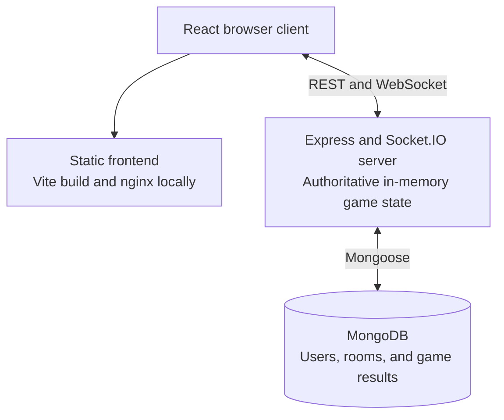

# ScribbleVerse

ScribbleVerse is a real-time multiplayer drawing and guessing game built with React, TypeScript, Express, Socket.IO, and MongoDB. Players create private rooms, take turns drawing server-selected words, guess through live chat, and compete for points across configurable rounds.

The project supports both guest play and persistent accounts. Authenticated players receive cumulative profile statistics and one leaderboard entry for every completed game.

## Highlights

- Real-time room, drawing, chat, scoring, timer, and turn synchronization with Socket.IO
- Server-authoritative game rules and identity checks
- Configurable round count and turn duration
- Automatic host reassignment when the host disconnects before a game
- Guest mode with no account requirement
- Email/password accounts with bcrypt password hashing
- Persistent JWT authentication through secure, httpOnly cookies
- Per-game authenticated leaderboard with duplicate-result protection
- Zod validation for untrusted Socket.IO and HTTP payloads
- Per-IP and per-socket rate limiting
- Structured Pino logs with credentials, cookies, and tokens redacted
- Liveness/readiness endpoints and graceful process shutdown
- Multi-stage Docker images and a complete local Docker Compose stack
- GitHub Actions validation for backend, frontend, and Docker images
- 48 backend unit and integration tests

## Architecture



Live room state—players, drawing order, current word, scores, and timers—is owned by one backend process. MongoDB stores account data, room metadata, cumulative user statistics, and authenticated per-game results.

## Technology stack

### Frontend

- React 19 and TypeScript
- Vite
- React Router
- Socket.IO Client
- Tailwind CSS
- Framer Motion and Lucide React

### Backend

- Node.js 20 and TypeScript
- Express 5
- Socket.IO
- MongoDB and Mongoose
- Zod
- bcryptjs and jsonwebtoken
- express-rate-limit and rate-limiter-flexible
- Pino and pino-http
- Vitest

### Delivery

- Docker and Docker Compose
- nginx static frontend server
- GitHub Actions CI

## Quick start with Docker

### Prerequisites

- Docker Desktop with Docker Compose
- Ports `5173`, `4000`, and `27017` available locally

### Run the complete application

```bash
git clone https://github.com/YugDesai7654/ScribbleVerse.git
cd ScribbleVerse
docker compose up -d --build --wait
```

Open [http://localhost:5173](http://localhost:5173).

The Compose stack starts:

- React/nginx frontend on `http://localhost:5173`
- Express/Socket.IO backend on `http://localhost:4000`
- MongoDB 7 on `mongodb://localhost:27017`

For local development, Compose uses a documented development-only JWT secret. Production startup rejects missing, short, or known development secrets.

Stop the stack without deleting MongoDB data:

```bash
docker compose down
```

Use `docker compose down -v` only when you intentionally want to delete local database data.

## Local setup without Docker

### 1. Backend

Create `socket-server/.env` from `socket-server/.env.example` and provide:

```dotenv
MONGO_URI=mongodb://localhost:27017/scribbleverse
PORT=4000
CORS_ORIGIN=http://localhost:5173
JWT_SECRET=replace-with-a-long-random-development-secret
NODE_ENV=development
LOG_LEVEL=info
```

Then run:

```bash
cd socket-server
npm ci
npm run build
npm start
```

### 2. Frontend

Create `react-client/.env` from `react-client/.env.example`:

```dotenv
VITE_SOCKET_URL=http://localhost:4000
```

Then run:

```bash
cd react-client
npm ci
npm run dev
```

Never commit real database credentials, JWT secrets, or cloud credentials.

## Authentication and leaderboard behavior

- Registration and login issue a seven-day JWT in an httpOnly cookie.
- REST requests use browser credentials, and Socket.IO sends the same cookie during its handshake.
- Logged-in players use their account display name inside game rooms.
- Guest players can use the full game flow but do not create persistent statistics.
- Every completed authenticated game creates an individual leaderboard record.
- The leaderboard is available only to authenticated users; logged-out visitors are redirected to login and returned afterward.
- Cumulative totals remain on the user profile, while the leaderboard displays separate game results.

## Health endpoints

| Endpoint              | Purpose                            | Success response                    |
| --------------------- | ---------------------------------- | ----------------------------------- |
| `GET /health/live`  | Process liveness                   | HTTP 200 while the process is alive |
| `GET /health`       | Application and database readiness | HTTP 200 when MongoDB is connected  |
| `GET /health/ready` | Explicit readiness alias           | HTTP 200 when MongoDB is connected  |

Readiness endpoints return HTTP 503 when the database is unavailable.

## Validation

### Backend

```bash
cd socket-server
npm run build
npm test
npm audit --omit=dev
```

The suite currently contains **48 tests** covering:

- Scoring and word-placeholder logic
- Zod validation boundaries
- Environment validation
- Liveness and readiness behavior
- Registration, login, logout, persistent cookies, and sanitized responses
- Authenticated leaderboard access and per-game sorting
- Full Socket.IO game flow
- Duplicate-name and room-cap rejection
- Host reassignment
- Authenticated result persistence and duplicate-start protection
- Turn-lifecycle regressions: no scoring after the word is revealed, no stalls when players leave, no stale word-pick timers
- Reserved-name rejection, foreign-Origin WebSocket rejection, room resume, and database-failure handling

### Frontend

```bash
cd react-client
npm run lint
npm run build
npm audit --omit=dev
```

### Complete container check

```bash
docker compose up -d --build --wait
docker compose ps
docker compose down
```

GitHub Actions runs backend build/tests, frontend lint/build, and both Docker image builds on pull requests and pushes to `main`.

## Project structure

```text
ScribbleVerse/
├── .github/workflows/ci.yml    # CI validation
├── docker-compose.yml          # Local frontend, backend, and MongoDB
├── react-client/
│   ├── src/components/         # Pages and game UI
│   ├── src/contexts/           # Persistent authentication state
│   ├── src/lib/                # Typed REST API client
│   ├── Dockerfile
│   └── nginx.conf
└── socket-server/
    ├── src/__tests__/          # Unit and integration tests
    ├── src/auth/               # JWT handling
    ├── src/model/              # MongoDB models
    ├── src/routes/             # Auth and leaderboard REST routes
    ├── src/validation/         # Zod network schemas
    ├── src/server.ts           # Express, Socket.IO, and game engine
    ├── src/index.ts            # Startup and graceful shutdown
    └── Dockerfile
```

## Author

Built by [Yug Desai](https://github.com/YugDesai7654).
